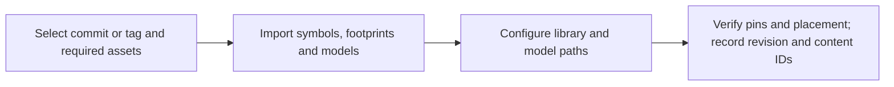
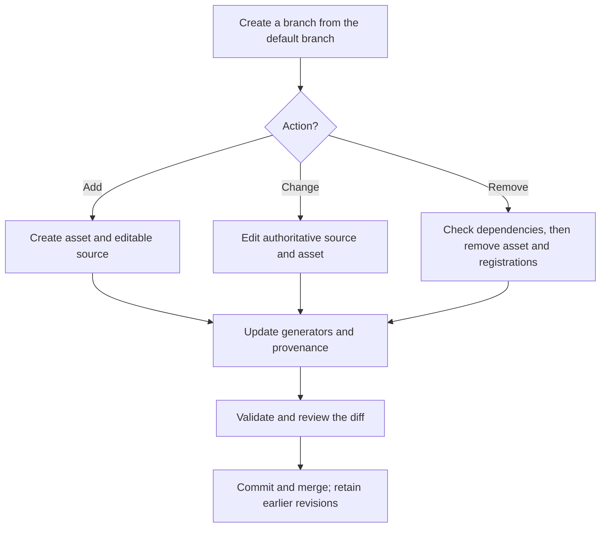

# Original Open-Hardware KiCad Component Library

Reusable KiCad 10 components and editable sources, authored by Gerhard Malberg
and licensed under CERN-OHL-P-2.0.

- **Symbols:** [one schematic symbol per library file](symbols/).
- **Footprints:** [PCB land patterns and artwork variants](footprints/custom_footprints.pretty/).
- **3D models and sources:** [STEP models](3d_models/custom_3dmodels.3dshapes/) and [editable FreeCAD/CadQuery sources](3d_models/sources/).
- **Tools and provenance:** [generation, validation and version tools](tools/) and the [asset register](ASSET_PROVENANCE.csv).

### Use components



### Maintain components



## Setup and use

Install KiCad 10. Place the selected library files beneath the directory
containing the consuming `.kicad_pro`, preserving this structure:

```text
kicad-libraries/
|-- symbols/                       individual or merged symbol libraries
|-- footprints/custom_footprints.pretty/
`-- 3d_models/custom_3dmodels.3dshapes/
```

Each source symbol has its own `.kicad_sym` file. Register individual files in
KiCad's project-specific symbol library table, or use the optional builder to
merge selected symbols into a project-local library. Keep merged outputs out
of this repository.

Run commands from this repository's root with Python 3.11+ installed. Examples
are paired for **Windows PowerShell** and **Debian-based Linux (Bash)**; replace sample paths
and `SYMBOL_NAME`. Linux uses `python3` where Windows examples use `python`.

**Windows (PowerShell)**

```powershell
$project = "C:/path/to/project"
python tools/build_symbol_library.py --list
python tools/build_symbol_library.py --symbols SYMBOL_NAME --output "$project/kicad-libraries/symbols/custom_symbols.kicad_sym"
```

**Debian-based Linux (Bash)**

```bash
project="/path/to/project"
python3 tools/build_symbol_library.py --list
python3 tools/build_symbol_library.py --symbols SYMBOL_NAME --output "$project/kicad-libraries/symbols/custom_symbols.kicad_sym"
```

For an existing schematic, select its referenced symbols with `--used-by`:

**Windows (PowerShell)**

```powershell
python tools/build_symbol_library.py --used-by "$project" --output "$project/kicad-libraries/symbols/custom_symbols.kicad_sym"
```

**Debian-based Linux (Bash)**

```bash
python3 tools/build_symbol_library.py --used-by "$project" --output "$project/kicad-libraries/symbols/custom_symbols.kicad_sym"
```

The default schematic nickname is `custom_symbols`; use `--nickname` for
another name. `--update` retains existing symbols while adding selected ones.
`--check` writes nothing and reports missing, stale or extra symbols.

For a merged library, add these entries to the respective project library
tables through KiCad's library manager:

```scheme
(sym_lib_table
  (lib (name "custom_symbols")(type "KiCad")(uri "${KIPRJMOD}/kicad-libraries/symbols/custom_symbols.kicad_sym")(options "")(descr "Imported symbols"))
)
```

```scheme
(fp_lib_table
  (lib (name "custom_footprints")(type "KiCad")(uri "${KIPRJMOD}/kicad-libraries/footprints/custom_footprints.pretty")(options "")(descr "Original component footprints"))
)
```

Copy the selected footprints and their referenced STEP files too. Original
models resolve through `${KIPRJMOD}/kicad-libraries/3d_models/custom_3dmodels.3dshapes/`.
Some footprints reference optional installed KiCad models through
`${KICAD10_3DMODEL_DIR}`; those models are not distributed here and retain their
upstream terms.

Check the asset's Description, datasheet, source comments and provenance row
before use. Land-pattern variants can differ from manufacturer recommendations,
and representative 3D models are not maximum-tolerance clearance envelopes.
Verify pin/pad mapping and mechanical fit in the actual assembly.

## Maintenance

Make shared changes in this repository, then deliberately re-import the chosen
revision. Keep imported copies unchanged for reliable content identification;
saving them through an editor can rewrite metadata without changing geometry.

- **Add:** create the asset and its editable source or generator definition;
  add its provenance row and any required model references.
- **Change:** update the authoritative source as well as the output. Preserve
  existing names and interfaces unless an intentional compatibility change is
  documented in the commit.
- **Remove:** check references, shared model users and generator registrations
  before deleting files and their active provenance rows. Do not remove a model
  still used by another footprint. Remove preservation-list entries where
  applicable so generation neither restores the asset nor fails on its absence.
  Earlier assets and provenance remain available in Git history.

Use descriptive filenames; each footprint filename must match its internal
name. Symbol filenames use lowercase names with non-alphanumeric runs replaced
by underscores. Keep pin anchors and lengths, graphic placement points and
visible Reference/Value origins on a 1.27 mm (50 mil) grid. Do not alter
connectivity, geometry or model transforms in a wording-only change.

Update the appropriate source rather than editing a generated file alone:

| Asset | Authoritative source / regeneration |
|---|---|
| Generated symbols and footprints | [KiCad generator](tools/generate_original_kicad_assets.py); run with Python 3.11+ |
| Preserved hand-maintained symbols | Existing individual symbol files; the generator preserves their blocks |
| FreeCAD models | [Model generator](tools/generate_original_freecad_models.py) and [FreeCAD macro](tools/generate_original_freecad_models.FCMacro), using FreeCAD 1.1.1 |
| CadQuery models | Corresponding Python source under `3d_models/sources/`, using CadQuery 2.8+ |

Bulk generators rewrite multiple assets. Run them in a disposable copy first
and review the complete diff. Check generated output a second time for
unintended drift. Keep caches, backups and temporary exports out of commits.

### Fabrication-layer standard

- F.Fab describes the physical body; F.CrtYd defines placement clearance.
  Preserve accurate outlines and applicable pin-one, polarity or orientation
  marks. Never enlarge the body to fit text.
- Keep one visible `${REFERENCE}` inside the fabrication body; hide Value and
  Description. Size or offset the reference to clear all outlines and marks,
  including when it reads `REF**`. Verify the same fit after flipping to B.Fab.
- Keep pads, copper, mask/paste, courtyards and model transforms unchanged when
  adjusting fabrication text. The [formatter](tools/fabrication_standard.py)
  contains the size/placement rules; do not duplicate per-part values here.
- Choose silkscreen artwork for the assembly and fabricator. Minimal variants
  retain fabrication detail and useful orientation marks, but still need
  board-level DRC against exposed mask openings. Discard tiny outline fragments;
  copper keepouts do not trim silkscreen.

Run the read-only checks with a Python interpreter that can import KiCad 10's
`pcbnew`. Windows uses KiCad's bundled Python. The Debian-based Linux examples
assume a native KiCad 10 installation with bindings available to system Python,
outside a virtual environment. Follow the [installation instructions for your
distribution](https://www.kicad.org/download/linux-distros/), then check that
the reported version is 10.x before running the geometry check.

**Windows (PowerShell)**

```powershell
$kicadPython = "C:/Program Files/KiCad/10.0/bin/python.exe"
& $kicadPython -c "import pcbnew; print(pcbnew.Version())"
$symbols = @(Get-ChildItem symbols -Filter *.kicad_sym -File | ForEach-Object FullName)
& $kicadPython -B tools/check_symbol_grid.py @symbols
& $kicadPython -B tools/fabrication_standard.py --geometry
```

**Debian-based Linux (Bash)**

```bash
/usr/bin/python3 -c "import pcbnew; print(pcbnew.Version())"
/usr/bin/python3 -B tools/check_symbol_grid.py symbols/*.kicad_sym
/usr/bin/python3 -B tools/fabrication_standard.py --geometry
```

Only when intentionally updating fabrication artwork, apply the formatter to
the selected footprint or directory (replace `<path>`):

**Windows (PowerShell)**

```powershell
& $kicadPython -B tools/fabrication_standard.py --apply "<path>"
```

**Debian-based Linux (Bash)**

```bash
/usr/bin/python3 -B tools/fabrication_standard.py --apply "<path>"
```

Review parser warnings, pin/pad definitions, model paths
and alignment in KiCad before merging. Check long reference names in the actual
board; the library checks cannot cover every possible designator.

## Version checking

Record the imported commit and content identifiers. One file per asset makes
its history inspectable with `git log -- "<path>"` (the same command in both
shells; replace `<path>`). A changed hash identifies
changed content; inspect the diff to understand its electrical significance.
Do not rewrite published history or force-push away referenced commits.

Use the existing tools for the scope being checked (replace angle-bracket
placeholders with actual paths):

**Windows (PowerShell)**

```powershell
python tools/identify_asset.py "<asset-or-merged-library>" --upstream "<library-checkout>"
python tools/identify_asset.py --manifest "<import-manifest>" --upstream "<library-checkout>"
python tools/check_vendored_library.py --vendored "<complete-copy>" --upstream "<library-checkout>"
```

**Debian-based Linux (Bash)**

```bash
python3 tools/identify_asset.py "<asset-or-merged-library>" --upstream "<library-checkout>"
python3 tools/identify_asset.py --manifest "<import-manifest>" --upstream "<library-checkout>"
python3 tools/check_vendored_library.py --vendored "<complete-copy>" --upstream "<library-checkout>"
```

`identify_asset.py` reports `EXACT`, `EQUIVALENT` (matching design facts despite
byte differences), or `DIVERGED`; use `--show-diff` to investigate differences.
The whole-copy checker requires a committed copy in Git. History-based
identification requires upstream commits; hashes alone do not establish a
published revision. See each tool's `--help` for options and exit codes.

Preserve `.gitattributes` conventions when importing: LF for text and binary
handling for models. Re-run the symbol builder with the same selection and
`--check` to verify a merged library without rewriting it.

## Licensing and provenance

Copyright (C) 2021-2026 Gerhard Malberg. All original content is licensed under
**CERN-OHL-P-2.0**, including documentation, metadata, tools and CAD sources.
The complete licence is in [LICENSE](LICENSE) and
[LICENSES/CERN-OHL-P-2.0.txt](LICENSES/CERN-OHL-P-2.0.txt).

[ASSET_PROVENANCE.csv](ASSET_PROVENANCE.csv) records each registered asset's
author, factual sources, licence, modifications and redistribution status.
Retain those facts when editing; keep licence/source metadata in STEP headers
and FreeCAD document properties. Datasheet links do not redistribute or
relicense manufacturer documents.

Public additions must be original, documented CERN-OHL-P-2.0 work marked
`cleared_original`. Do not add restricted, unverified or third-party-derived
CAD or manufacturer PDFs. `NOASSERTION` is allowed only as a source URL for a
generic original convention, never as a licence grant. Retain copyright and
other applicable notices; see [THIRD_PARTY_NOTICES.txt](THIRD_PARTY_NOTICES.txt).

Files are provided as-is, without warranty. Independently verify dimensions,
electrical mappings and suitability before manufacture or use. Manufacturer
names identify compatibility or sources and do not imply endorsement.
